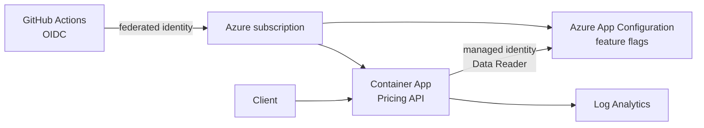
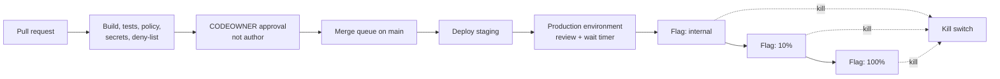

# Feature-flag release gates

Shipping code safely is different from merging code safely. A pull request can be reviewed and green while the release still needs a controlled exposure, an operational escape hatch, and evidence of who approved production. This sample is a small pricing calculator for fictional Northwind Widgets that makes those controls executable.

The pattern is deliberately boring:

1. Merge only after required checks and a CODEOWNER approval from somebody other than the author.
2. Keep risky behavior dark behind generic feature flags.
3. Roll out through an internal group, a deterministic ten-percent audience, and then one hundred percent.
4. Deploy staging before production, with a production environment approval and wait timer.
5. Keep a kill switch in the same configuration plane so it can override every feature without a new image.

Architecture

Release flow

Local quick start

The .NET 8 SDK is expected at `~/.local/bin/dotnet`. Run the complete local verification in one command:

    make test

Run the API afterward with `make run`. It listens on port 8080. Example requests:

    curl http://localhost:8080/health
    curl -X POST http://localhost:8080/quote -H 'content-type: application/json' -d '{"productId":"NW-ALPHA","quantity":10,"region":"US","userId":"customer-7"}'
    curl 'http://localhost:8080/features?userId=customer-7'

The local app uses `src/PricingApi/appsettings.json`. If `AzureAppConfigurationEndpoint` or `AZURE_APPCONFIG_ENDPOINT` is set, the application adds the Azure App Configuration provider with `DefaultAzureCredential`, feature-flag refresh, and no connection string.

Gate matrix

| Gate | Enforced by | Purpose |
| --- | --- | --- |
| Build and xUnit integration tests | `build-test` | Proves quote math, targeting, reload, and API behavior |
| Rego policy | `policy` and `pr-policy` | Requires a second-person CODEOWNER approval, successful required checks, changed tests or an explicit exception, main, and merge queue |
| Secret scan | `gitleaks` | Prevents credentials from entering history |
| Deny-list | `deny-list` | Scans tracked files for locally supplied forbidden strings |
| Branch protection | `.github/settings.yml` | Requires checks, CODEOWNER review, stale-review dismissal, and no force pushes |
| Environment gate | `deploy.yml` | Staging precedes production; production has reviewers and a wait timer |

Rollout and kill switch

The declarative starting point is `flags/flags.json`. To see the Azure CLI commands for a stage without changing Azure, use the default dry run:

    make rollout-dry
    DRY_RUN=1 bash scripts/rollout.sh internal
    DRY_RUN=1 bash scripts/rollout.sh 100
    DRY_RUN=1 bash scripts/rollout.sh kill

Set `DRY_RUN=0`, `APP_CONFIG_NAME`, and `LABEL` only from an authenticated operator shell when applying the same commands to an App Configuration store. The API uses `VolumeDiscounts` and `RegionalTax` with the built-in targeting filter. Internal users are selected by group; everybody else receives a stable hash-based ten-percent exposure. The `KillSwitch` check happens before either feature and returns base, untaxed pricing as soon as configuration refreshes.

For a local-only rehearsal, use `python3 scripts/rollout_local.py 10` or `python3 scripts/rollout_local.py kill`. The API's integration test changes a reloadable configuration provider and proves that the kill switch takes effect without restarting the process.

Tradeoffs

Feature flags create debt: every temporary flag needs an owner, an expiry, and removal work. Azure App Configuration refresh is not magic; refresh intervals and provider availability determine how quickly a kill switch reaches every replica. App Configuration, Container Apps, and Log Analytics add cost and operational surface compared with environment variables. The two-person rule is intentionally awkward for a solo maintainer; the live PR policy job is soft-fail in this sample because a repository cannot self-approve, while branch protection remains the real control for a team.

What I would do in production

Use a real CODEOWNERS team rather than the placeholder handle, keep required checks configured in the repository API, and make the PR policy job a required check once a second maintainer exists. Add flag ownership and expiry metadata, alert on kill-switch activation, and exercise the rollback path regularly. Restrict App Configuration network access with private endpoints where practical, use a separate store or label per environment, and verify that every replica has refreshed before increasing exposure. Add product-level contract tests, SLO dashboards, and deployment records that link the image digest, PR, flag state, approvers, and incident timeline.
